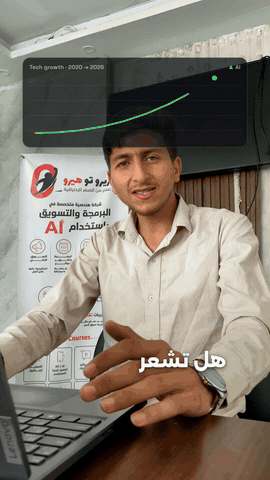

# Zero to Hero — course ad reel

> ريل إعلان لكورس «زيرو تو هيرو» — ترجمة عربية كلمة بكلمة وجرافيك واجهات حوالين المتحدث.

<p align="center"></p>

A 44-second Instagram reel for a programming & marketing course, edited from **7 iPhone clips** of a talking head.

**Watch:** [portfolio](https://suliman-hasanien.github.io/#work)

## Pipeline
1. **Transcribe** — `project/transcribe.py` runs faster-whisper (large-v3) on the Arabic speech for word timings.
2. **Captions** — `project/make_captions.py` → `project/captions.json`: lines, words, key words, trims, cuts and transitions in one editable file.
3. **Base edit** — `python project/build.py --base`: FFmpeg trims, punch-in zooms, whip/zoom joins, denoised and levelled audio → `remotion/public/base.mp4` + `timeline.json`.
4. **Speaker matte** — `python project/matte.py <start> <end>` (Robust Video Matting, ONNX) cuts the speaker out so UI graphics can sit *behind* him.
5. **Motion layer** — `remotion/src/`: word-by-word Arabic captions with highlighted key words and UI cards (code editor, chart, progress bar, portfolio…) timed to the words.
6. **Sound** — `project/make_music.py`, `project/make_sfx.py`: original bed + pops, clicks, risers.

```bash
cd remotion && npm install
npx remotion render src/index.ts Reel out.mp4
```
The source clips and models are not included (`models/`, `*.mp4` are ignored).

## Stack
Python · faster-whisper · ONNX Runtime (RVM) · FFmpeg · Remotion 4 · React · TypeScript

---
Built by **Suliman Hasanien** with an AI-assisted workflow (Claude Code). Client work shown with permission.
Fonts: Alexandria, Cairo, IBM Plex Sans Arabic, Tajawal, Anton, Space Grotesk (SIL OFL).
